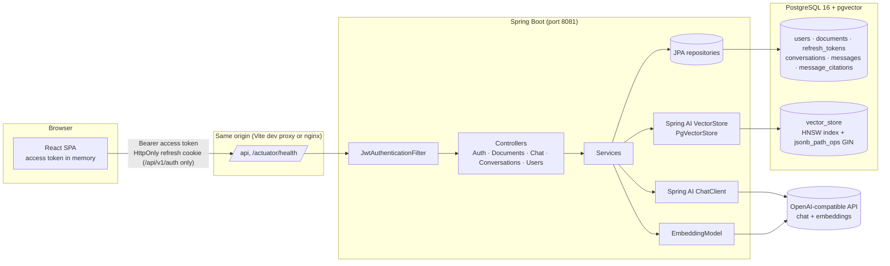
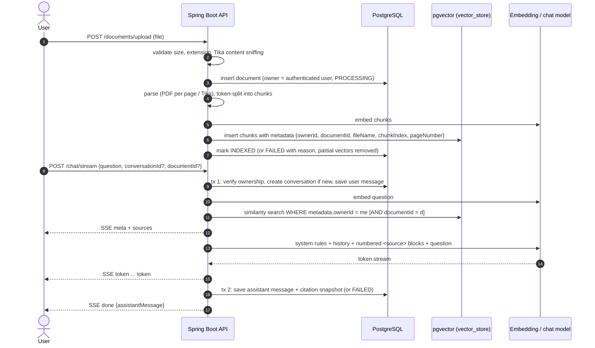
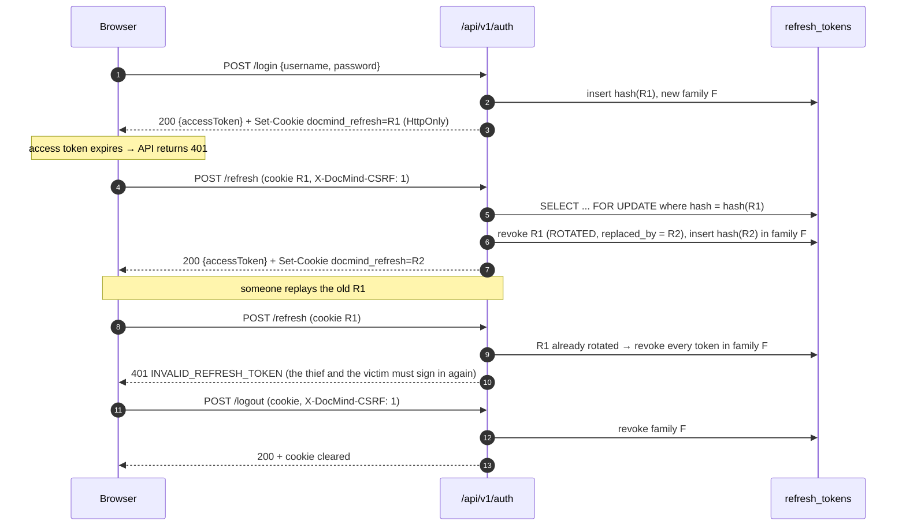

# DocMind

**DocMind is a full-stack AI document workspace.** Upload your own PDFs, Word files and text documents, then ask questions about them in a chat interface. Answers are generated with retrieval-augmented generation (RAG) over a PostgreSQL + pgvector index, cite the exact passages they came from, and every conversation is saved so you can come back to it.

Each account is a private workspace: documents, vector chunks, search results, conversations and citations are isolated per user at the database and vector-query level, not just in the UI.

| | |
|---|---|
| **Backend** | Java 17 · Spring Boot 4.1 · Spring Security 7 · Spring Data JPA · Spring AI 2.0 · Flyway · JJWT |
| **Data** | PostgreSQL 16 + pgvector (HNSW, cosine distance) |
| **Frontend** | React 19 · TypeScript (strict) · Vite 7 · React Router 7 · TanStack Query 5 · Tailwind CSS 4 · Lucide |
| **Testing** | JUnit 5 · Mockito · Spring MockMvc · Testcontainers (real pgvector) · Vitest · Testing Library |

---

## Contents

1. [Features](#features)
2. [Screenshots](#screenshots)
3. [Architecture](#architecture)
4. [Authentication and refresh-token lifecycle](#authentication-and-refresh-token-lifecycle)
5. [Per-user data isolation](#per-user-data-isolation)
6. [Data model](#data-model)
7. [Vector search design](#vector-search-design)
8. [Chat history persistence](#chat-history-persistence)
9. [Repository structure](#repository-structure)
10. [Running locally](#running-locally)
11. [Environment variables](#environment-variables)
12. [Docker Compose](#docker-compose)
13. [API reference and examples](#api-reference-and-examples)
14. [Testing](#testing)
15. [Security considerations](#security-considerations)
16. [Troubleshooting](#troubleshooting)
17. [Known limitations](#known-limitations)
18. [Future improvements](#future-improvements)

---

## Features

**Documents**
- Upload by drag-and-drop or file picker with real upload progress, single or multiple files.
- Supported formats: PDF (parsed page by page, so citations carry page numbers), DOCX, DOC, PPTX, ODT, RTF, TXT, Markdown, CSV and HTML (via Apache Tika).
- File content is sniffed with Tika; a file whose bytes do not match its extension is rejected (`415`), as are empty files and files over 25 MB.
- Processing status is persisted (`PROCESSING` → `INDEXED` or `FAILED`). Documents with no extractable text (for example scanned, image-only PDFs) are marked `FAILED` with a reason, never `INDEXED`.
- Library with size, chunk count, upload date and status, a details panel, and delete with confirmation (removes the vector chunks in the same transaction).

**Chat**
- Ask across all of your documents or scope a question to one document.
- Answers stream token by token over Server-Sent Events. Stopping the stream does not lose the answer: the server finishes and saves it.
- Inline citation markers (`[1]`, `[2]`) link to a sources panel with file name, page, similarity score and the retrieved passage. Markers are only rendered for sources that were actually retrieved.
- Follow-up questions include recent conversation history.
- If the AI provider fails, the question is still saved, the failure is shown in place, and **Retry** regenerates the answer without duplicating the question.
- Copy answer, Enter to send, Shift+Enter for a newline, first-use suggestions.

**Search and history**
- Semantic (vector) search over your own passages from the library, optionally within one document.
- Conversation history grouped by date (Today, Yesterday, Previous 7 days, …), searchable by title and message content, with rename and delete.

**Account**
- Registration and login (username or email), profile email update, password change (signs out every session), light/dark/system theme, sign-out that revokes the session server-side.
- Responsive layout: collapsible sidebar on desktop, slide-in drawer on tablet and mobile.

## Screenshots

> Screenshots are not committed yet. To add them, run the app locally and capture:
>
> | File | What to capture |
> |---|---|
> | `docs/screenshots/chat.png` | A conversation with a cited answer and the sources panel open |
> | `docs/screenshots/library.png` | The library with a few indexed documents and the semantic search |
> | `docs/screenshots/login-dark.png` | The sign-in page in dark theme |
> | `docs/screenshots/mobile.png` | The chat view with the navigation drawer open at phone width |

The visual design takes its cues from an editorial style: a warm paper-and-ink palette with a single terracotta accent, Fraunces serif headlines, Inter for interface text, uppercase JetBrains Mono micro-labels, hairline borders and restrained motion. Both themes are built from the same CSS variables in [`frontend/src/index.css`](frontend/src/index.css).

---

## Architecture



The backend keeps the original layered structure (controller → service → repository) and the Spring AI `ChatClient` / `VectorStore` abstractions. Controllers are thin; ownership checks live in services and repository finders; DTOs are used at every API boundary.

### Document ingestion and question answering



---

## Authentication and refresh-token lifecycle

DocMind uses two separate credentials:

| | Access token | Refresh token |
|---|---|---|
| Format | HMAC-signed JWT via JJWT (HS256–HS512, chosen from the key length) | 256 random bits from `SecureRandom`, base64url, opaque |
| Lifetime | 15 minutes (`JWT_ACCESS_TTL`) | 7 days (`REFRESH_TOKEN_TTL`) |
| Where the client keeps it | JavaScript memory only | `HttpOnly`, `SameSite=Strict` cookie, `Path=/api/v1/auth` |
| Where the server keeps it | Nowhere (stateless) | SHA-256 hash in `refresh_tokens` |
| Claims / data | `sub` = user id, `typ=access`, `iss`, `iat`, `exp`, `jti` | user, family id, expiry, revocation time and reason, replacement id |



Details worth knowing:

- **Purpose separation.** The filter only accepts JWTs with `typ=access`; opaque refresh tokens are not JWTs and are never accepted as bearer tokens, and the refresh endpoint only reads the cookie, so an access token cannot be used there. Both directions are covered by tests.
- **Strict validation.** Signature, issuer, expiry and token type are checked; malformed, tampered and expired tokens get `401` with `INVALID_TOKEN` or `TOKEN_EXPIRED` immediately instead of falling through as anonymous. The user is reloaded from the database on every request, so a deleted account cannot keep using an old token.
- **Secrets.** `JWT_SECRET` (≥ 32 bytes) is mandatory outside the `dev` profile; the application refuses to start without it. In `dev` only, a random per-process key is generated when it is unset.
- **Concurrency.** Rotation takes a row lock on the presented token. If two tabs refresh at the same moment, the loser gets `409 REFRESH_CONFLICT` (within a 10 s grace window) instead of triggering theft detection; the browser already holds the winner's new cookie, so the client simply retries once. In the frontend, concurrent `401`s within one tab share a single in-flight refresh, and every request is retried at most once.
- **CSRF.** Bearer-token endpoints are immune to CSRF because browsers never attach the header automatically, so Spring's synchronizer-token filter is disabled for them. The two cookie-authenticated endpoints (`/refresh`, `/logout`) are protected by `CookieCsrfGuard`: the `SameSite=Strict` cookie, a mandatory `X-DocMind-CSRF` header (a cross-site form cannot send it, and a cross-origin script would need a CORS preflight that the exact-origin allowlist rejects), and an `Origin` check.
- **Cleanup.** A scheduled job (`app.security.refresh.cleanup-cron`, daily at 03:15) deletes tokens that expired or were revoked more than 7 days ago. Revoked rows are kept for a while so reuse can still be detected.
- **Password change** revokes every refresh token of the account.

## Per-user data isolation

Isolation is enforced on the server, at three layers:

1. **Identity comes from the token.** Controllers receive an `AuthUser` principal built from the database record of the JWT subject. No endpoint accepts a user id from the request.
2. **Every relational query is owner-scoped.** Documents and conversations are only ever loaded with finders such as `findByIdAndOwnerId(id, ownerId)`; messages are only loaded through a conversation that was verified first. Another user's resource therefore behaves exactly like a missing one and returns `404` — the API does not reveal whether it exists.
3. **Every vector query is owner-scoped inside SQL.** Each chunk carries `ownerId` and `documentId` in its pgvector metadata, and every similarity search and delete passes a Spring AI filter expression that PgVectorStore compiles into a `metadata::jsonb @@ '$.ownerId == "42"'` predicate. Other users' vectors are never fetched and then filtered in memory. A document-scoped request additionally checks document ownership first (`404` otherwise) and adds `documentId` to the filter.

The isolation tests create two users with deliberately overlapping documents and assert that listing, fetching, deleting, semantic search, document-scoped search, chat retrieval (including the exact prompt sent to the model) and every conversation/message endpoint only ever expose the caller's own data.

## Data model

```mermaid
erDiagram
    USERS ||--o{ DOCUMENTS : owns
    USERS ||--o{ REFRESH_TOKENS : has
    USERS ||--o{ CONVERSATIONS : owns
    CONVERSATIONS ||--o{ MESSAGES : contains
    MESSAGES ||--o{ MESSAGE_CITATIONS : cites
    DOCUMENTS ||..o{ VECTOR_STORE : "chunks (metadata.documentId, metadata.ownerId)"

    USERS { bigint id PK; varchar username UK; varchar email UK; varchar password "BCrypt"; varchar role; timestamptz created_at }
    DOCUMENTS { uuid id PK; bigint owner_id FK; varchar filename; varchar content_type; bigint file_size; int total_pages; int total_chunks; varchar status; text error_message; timestamptz created_at; timestamptz updated_at }
    REFRESH_TOKENS { uuid id PK; bigint user_id FK; varchar token_hash UK; uuid family_id; timestamptz expires_at; timestamptz revoked_at; varchar revoked_reason; uuid replaced_by_id }
    CONVERSATIONS { uuid id PK; bigint owner_id FK; varchar title; timestamptz created_at; timestamptz updated_at }
    MESSAGES { uuid id PK; uuid conversation_id FK; varchar role; varchar status; text content; uuid document_id; uuid reply_to_id; uuid client_message_id; bigint response_time_ms; timestamptz created_at }
    MESSAGE_CITATIONS { uuid message_id PK; int position PK; uuid document_id; varchar file_name; int chunk_index; int page_number; text snippet; float similarity_score }
    VECTOR_STORE { uuid id PK; text content; json metadata; vector embedding "1536 dims" }
```

All foreign keys cascade on delete. Usernames and emails are unique case-insensitively (`lower()` unique indexes). `message_citations` deliberately has no foreign key to `documents`: citations are a snapshot, so past answers stay readable after a document is deleted.

### Migrations

The schema is owned by Flyway (`src/main/resources/db/migration`), and Hibernate runs with `ddl-auto: validate`.

| Version | Contents |
|---|---|
| `V1__baseline.sql` | `vector` extension, `users`, `documents`, `vector_store` (+ HNSW, GIN and expression indexes) |
| `V2__refresh_tokens.sql` | Refresh-token table and indexes |
| `V3__conversations.sql` | `conversations`, `messages`, `message_citations` |

**Upgrading an existing development database.** Earlier versions of this project created tables with Hibernate `ddl-auto=update`, including a table literally named `"document metadata"`. Flyway is configured with `baseline-on-migrate=true` and `baseline-version=0`, and `V1` is idempotent, so on such a database it:

- renames `"document metadata"` to `documents` (and its constraints),
- converts timestamp columns to `timestamptz`,
- adds `owner_id` with a foreign key — rows uploaded before documents had owners cannot be attributed safely, so they are **moved to a `legacy_unowned_documents` table instead of being deleted**; their old vectors have no `ownerId` and are therefore never returned by any search.

This upgrade path is covered by `LegacySchemaMigrationTest`. If you want to keep legacy documents, re-upload them; or assign them manually by inserting rows back into `documents` with an `owner_id` and adding `"ownerId": "<id>"` to their `vector_store.metadata`.

## Vector search design

- **Store:** Spring AI `PgVectorStore` on the `vector_store` table, 1536 dimensions (`text-embedding-3-small`), cosine distance, HNSW index. The table is created by Flyway (`initialize-schema: false`).
- **Chunking:** `TokenTextSplitter` (700-token target chunks, configurable under `app.rag`). Chunk metadata is rebuilt from scratch so only known keys are stored: `ownerId`, `documentId`, `fileName`, `contentType`, `chunkIndex`, `pageNumber`. Ids are stored as JSON strings so the generated jsonpath compares like with like.
- **Ownership filter:** `VectorMetadata.ownedBy(ownerId)` / `ownedDocument(ownerId, documentId)` build the filter expressions used for every search and every delete. A GIN `jsonb_path_ops` index on `metadata::jsonb` supports the jsonpath predicate.
- **Filtered HNSW recall:** with a selective filter, a plain HNSW scan can return fewer than `topK` rows. Each connection sets `hnsw.iterative_scan = relaxed_order` (pgvector ≥ 0.8) so the index keeps scanning until enough of the caller's rows are found.
- **Bounds:** `topK` defaults to 5 and is capped at 20; `minSimilarity` is validated to `[0, 1]`; queries are limited to 2,000 characters; citation snippets to 600 characters. Empty result sets are a normal `200` with `totalMatches: 0`.
- **Prompting:** retrieved chunks are passed as numbered `<source id="n">` blocks in the user turn. The system prompt states that source content is untrusted data, never instructions, that only provided ids may be cited, and how to answer when nothing relevant was found. Document text cannot close or open source tags (they are neutralised), and messages are passed as message objects so document text is never run through a prompt template engine.

## Chat history persistence

Every exchange is stored in PostgreSQL:

1. **Transaction 1** — verify the conversation belongs to the caller (or create one, titled from the first question), validate the optional document scope, reject a repeated `clientMessageId` (`409`), and save the user message. This commits before any AI call, so the question is never lost.
2. **Retrieval and generation** run outside any transaction.
3. **Transaction 2** — save the assistant message with its response time and a snapshot of every retrieved source (position, document, file, page, chunk, snippet, score). On failure an assistant message with status `FAILED` is saved instead; `retryOfMessageId` replaces it later.

For streaming, the user message and sources are sent first, then tokens, then a `done` event carrying the persisted message. If the client disconnects, generation continues and is persisted; the frontend polls the conversation for a short while after the user presses Stop. Conversations survive restarts because nothing is held in memory between requests.

## Repository structure

```
docmind/
├── pom.xml                       Maven build (Spring Boot 4.1.1, Spring AI 2.0.1)
├── Dockerfile                    Backend image
├── docker-compose.yml            PostgreSQL+pgvector; optional full stack (profile "app")
├── init.sql                      Extensions for a fresh Postgres container
├── .env.example                  Environment variable template
├── src/main/java/com/example/docmind/
│   ├── config/                   AppProperties, SecurityConfig (filter chain, CORS), ProjectConfig (ChatClient, OpenAPI)
│   ├── security/                 JwtService, JwtAuthenticationFilter, CookieCsrfGuard, JSON 401/403 handler, AuthUser
│   ├── controller/               Auth, Users, Documents, Chat (query/stream/search), Conversations
│   ├── service/                  Auth, RefreshToken, User, Document*, Retrieval, Rag, Chat, Conversation
│   ├── repository/               Owner-scoped Spring Data repositories
│   ├── entity/                   User, DocumentMetadata, RefreshToken, Conversation, Message, Citation
│   ├── dto/                      Request/response DTOs and the ApiResponse envelope
│   └── exception/                ApiException hierarchy and GlobalExceptionHandler
├── src/main/resources/
│   ├── application.yaml          Base (production-safe) configuration
│   ├── application-dev.yml       Local development defaults
│   └── db/migration/             Flyway migrations V1–V3
├── src/test/java/...             Integration tests (Testcontainers) and unit tests
└── frontend/
    ├── Dockerfile, nginx.conf    Static build served by nginx, /api proxied to the backend
    ├── .env.example
    └── src/
        ├── api/                  Typed client: token handling, refresh, upload progress, SSE parsing
        ├── app/                  Router (code-split pages), route guards, error screens
        ├── providers/            Auth, theme and toast state
        ├── hooks/, features/     React Query hooks, chat session, upload queue
        ├── components/           ui/, layout/, chat/, documents/
        └── pages/                Login, Register, Chat, Library, Settings
```

---

## Running locally

### Prerequisites

- **JDK 17+** (the Maven wrapper downloads Maven itself)
- **Node.js 20.19+** (22 or 24 recommended) and npm
- **Docker** (for PostgreSQL + pgvector, and for the backend integration tests)
- An **OpenAI API key** (or an OpenAI-compatible endpoint) for embeddings and chat. Without it the app still runs, but indexing and answering fail with clear error states.

### 1. Start PostgreSQL with pgvector

```bash
docker compose up -d postgres
```

This starts `pgvector/pgvector:pg16` on **localhost:5434** (database `docmind`, user `postgres`, password `postgres` by default — local development only). Flyway creates the schema when the backend starts.

### 2. Start the backend

```bash
export OPENAI_API_KEY=sk-your-key
./mvnw spring-boot:run
```

On Windows PowerShell:

```powershell
$env:OPENAI_API_KEY = "sk-your-key"
.\mvnw.cmd spring-boot:run
```

The API listens on **http://localhost:8081**. The `dev` profile is active by default; it supplies the local database credentials, allows `http://localhost:5173` for CORS, and generates a temporary JWT signing key if `JWT_SECRET` is not set (access tokens then become invalid after a restart, but the refresh cookie keeps you signed in).

### 3. Start the frontend

```bash
cd frontend
npm install
npm run dev
```

Open **http://localhost:5173**. Vite proxies `/api` and `/actuator/health` to `http://localhost:8081` (override with `DEV_API_PROXY_TARGET` in `frontend/.env`), so the browser sees a single origin.

### 4. Try it

Create an account, upload a document in **Library**, wait for the status to become *Indexed*, then ask a question in **Chat**.

## Environment variables

Backend (see [`.env.example`](.env.example)):

| Variable | Default | Purpose |
|---|---|---|
| `SPRING_PROFILES_ACTIVE` | `dev` | Use any other value (for example `docker` or `prod`) to disable development defaults |
| `SERVER_PORT` | `8081` | HTTP port |
| `DB_HOST` / `DB_PORT` / `DB_NAME` | `localhost` / `5434` / `docmind` | PostgreSQL location |
| `DB_USER` / `DB_PASSWORD` | dev: `postgres` / `postgres`; otherwise **required** | Database credentials |
| `JWT_SECRET` | dev: random per process; otherwise **required** | HMAC signing key, at least 32 bytes (`openssl rand -base64 48`) |
| `JWT_ACCESS_TTL` | `15m` | Access-token lifetime |
| `REFRESH_TOKEN_TTL` | `7d` | Refresh-token lifetime |
| `REFRESH_COOKIE_SECURE` | `true` (dev: `false`) | `Secure` flag on the refresh cookie; must be `true` over HTTPS |
| `REFRESH_COOKIE_SAME_SITE` | `Strict` | Use `None` (with `Secure`) only for a cross-site frontend |
| `CORS_ALLOWED_ORIGINS` | empty (dev: `http://localhost:5173,http://127.0.0.1:5173`) | Comma-separated exact origins; `*` is rejected at startup |
| `OPENAI_API_KEY` | dev: placeholder; otherwise **required** | Provider API key |
| `OPENAI_CHAT_MODEL` | `gpt-4o-mini` | Chat model |
| `OPENAI_EMBEDDING_MODEL` | `text-embedding-3-small` | Must output 1536-dimensional vectors |
| `SPRING_AI_OPENAI_BASE_URL` | OpenAI | Base URL for an OpenAI-compatible provider |
| `MAX_UPLOAD_SIZE` / `MAX_REQUEST_SIZE` | `25MB` / `100MB` | Multipart limits |

Further tuning (`app.rag.*` chunk size, top-K, history length, snippet length; `app.documents.*` allowed extensions and files per request) lives in `application.yaml`.

Frontend (see [`frontend/.env.example`](frontend/.env.example)):

| Variable | Default | Purpose |
|---|---|---|
| `VITE_API_BASE_URL` | empty (same origin) | Only set for a cross-origin API deployment |
| `DEV_API_PROXY_TARGET` | `http://localhost:8081` | Where the Vite dev server proxies `/api` |

No secret is ever exposed to the frontend; the browser only talks to the DocMind API.

## Docker Compose

Database only (for local development, as above):

```bash
docker compose up -d postgres
```

Full stack (PostgreSQL + backend + nginx-served frontend):

```bash
cp .env.example .env
# edit .env: set JWT_SECRET (openssl rand -base64 48) and OPENAI_API_KEY
docker compose --profile app up -d --build
```

| Service | URL |
|---|---|
| Web app (nginx, proxies `/api` to the backend) | http://localhost:8080 |
| Backend API / Swagger UI | http://localhost:8081/swagger-ui.html |
| PostgreSQL | localhost:5434 |

The backend runs with `SPRING_PROFILES_ACTIVE=docker`, so none of the development fallbacks apply. Compose waits for the database health check before starting the backend, and for the backend's `/actuator/health` before starting the frontend. nginx sets a strict Content-Security-Policy and other security headers and disables proxy buffering on `/api` so streamed answers arrive token by token. Behind HTTPS, set `REFRESH_COOKIE_SECURE=true`.

Stop with `docker compose --profile app down` (add `-v` to delete the database volume).

---

## API reference and examples

Interactive documentation: **http://localhost:8081/swagger-ui.html** (OpenAPI JSON at `/v3/api-docs`). Click **Authorize** and paste an access token to call protected endpoints.

Every JSON response uses one envelope:

```json
{ "success": false, "message": "Validation failed", "error": "VALIDATION_FAILED",
  "data": { "email": "Email must be valid" }, "timestamp": "2026-10-11T10:00:00Z" }
```

| Endpoint | Auth | Description |
|---|---|---|
| `POST /api/v1/auth/register` | public | Create an account and sign in (`201`; `409 USERNAME_TAKEN` / `EMAIL_TAKEN`) |
| `POST /api/v1/auth/login` | public | Username or email + password (`401 INVALID_CREDENTIALS`) |
| `POST /api/v1/auth/refresh` | refresh cookie + `X-DocMind-CSRF` | Rotate the session (`401 INVALID_REFRESH_TOKEN`, `409 REFRESH_CONFLICT`) |
| `POST /api/v1/auth/logout` | refresh cookie + `X-DocMind-CSRF` | Revoke the session and clear the cookie |
| `GET /api/v1/auth/me` | bearer | Current user |
| `PATCH /api/v1/users/me` | bearer | Update email |
| `POST /api/v1/users/me/password` | bearer | Change password (revokes all sessions) |
| `POST /api/v1/documents/upload` | bearer | Upload one file (multipart field `file`) |
| `POST /api/v1/documents/upload-multiple` | bearer | Upload up to 10 files (field `files`), per-file results |
| `GET /api/v1/documents` | bearer | List own documents |
| `GET /api/v1/documents/{id}` | bearer | Document metadata (`404` if not yours) |
| `DELETE /api/v1/documents/{id}` | bearer | Delete document and its vectors |
| `POST /api/v1/chat/query` | bearer | Ask and wait for the full answer |
| `POST /api/v1/chat/stream` | bearer | Ask and stream the answer (SSE) |
| `POST /api/v1/chat/search/similarity` | bearer | Semantic search over own chunks |
| `GET /api/v1/conversations?q=&page=&size=` | bearer | List / search conversations, most recent first |
| `POST /api/v1/conversations` | bearer | Create an empty conversation |
| `GET /api/v1/conversations/{id}` | bearer | Conversation with all messages and citations |
| `GET /api/v1/conversations/{id}/messages?page=&size=` | bearer | Paged messages, chronological |
| `PATCH /api/v1/conversations/{id}` | bearer | Rename |
| `DELETE /api/v1/conversations/{id}` | bearer | Delete with all messages |
| `GET /actuator/health` | public | Liveness (`{"status":"UP"}`) |

### Examples

Register (the refresh token arrives only as a cookie; `-c` stores it):

```bash
curl -s -c cookies.txt -X POST http://localhost:8081/api/v1/auth/register \
  -H 'Content-Type: application/json' \
  -d '{"username":"ada","email":"ada@example.com","password":"<a password of 8+ characters>"}'
```

```json
{
  "success": true,
  "message": "Account created",
  "data": {
    "accessToken": "<jwt>",
    "tokenType": "Bearer",
    "expiresIn": 900,
    "user": { "id": 1, "username": "ada", "email": "ada@example.com", "role": "USER", "createdAt": "2026-10-11T10:00:00Z" }
  },
  "timestamp": "2026-10-11T10:00:00Z"
}
```

Refresh the session:

```bash
curl -s -b cookies.txt -c cookies.txt -X POST http://localhost:8081/api/v1/auth/refresh -H 'X-DocMind-CSRF: 1'
```

Upload a document:

```bash
curl -s -X POST http://localhost:8081/api/v1/documents/upload \
  -H "Authorization: Bearer $TOKEN" -F 'file=@handbook.pdf'
```

```json
{ "success": true, "message": "Document uploaded and indexed successfully",
  "data": { "id": "3f6c…", "filename": "handbook.pdf", "fileSize": 182344, "status": "INDEXED", "chunksCreated": 42,
            "message": "Document successfully processed and indexed." }, "timestamp": "…" }
```

Ask a question (omit `conversationId` to start a new conversation):

```bash
curl -s -X POST http://localhost:8081/api/v1/chat/query \
  -H "Authorization: Bearer $TOKEN" -H 'Content-Type: application/json' \
  -d '{"question":"How much notice do vacation requests need?","clientMessageId":"7d1f4a60-6a50-4d1e-9a44-2f3a0b9d2c11"}'
```

```json
{
  "success": true,
  "data": {
    "conversation": { "id": "b52e…", "title": "How much notice do vacation requests need?", "createdAt": "…", "updatedAt": "…" },
    "userMessage": { "id": "…", "role": "USER", "status": "COMPLETE", "content": "How much notice do vacation requests need?", "citations": [] },
    "assistantMessage": {
      "id": "…", "role": "ASSISTANT", "status": "COMPLETE", "replyToId": "…", "responseTimeMs": 1840,
      "content": "Vacation requests need two weeks' notice [1].",
      "citations": [ { "position": 1, "documentId": "3f6c…", "fileName": "handbook.pdf", "pageNumber": 4, "chunkIndex": 11,
                       "snippet": "Vacation requests must be submitted at least two weeks…", "similarityScore": 0.83 } ]
    }
  }
}
```

If the model fails, the response is `502 AI_GENERATION_FAILED` and `data` still contains the saved question and a `FAILED` assistant message; send `{"conversationId": "…", "retryOfMessageId": "<userMessage.id>"}` to retry.

Streaming (`POST /api/v1/chat/stream`, `Accept: text/event-stream, application/json`) emits:

```
event:meta     data:{"conversation":{…},"userMessage":{…}}
event:sources  data:[{"position":1,"fileName":"handbook.pdf",…}]
event:token    data:{"text":"Vacation requests "}
event:token    data:{"text":"need two weeks' notice [1]."}
event:done     data:{"assistantMessage":{…}}
```

or `event:error data:{"message":"…","assistantMessage":{…}}` instead of `done`. Validation and ownership errors are returned as ordinary JSON responses before the stream starts, which is why the request must also accept `application/json`.

Semantic search:

```bash
curl -s -X POST http://localhost:8081/api/v1/chat/search/similarity \
  -H "Authorization: Bearer $TOKEN" -H 'Content-Type: application/json' \
  -d '{"query":"remote work policy","topK":5}'
```

### Common error codes

| HTTP | `error` | Meaning |
|---|---|---|
| 400 | `VALIDATION_FAILED`, `BAD_REQUEST`, `EMPTY_FILE`, `TOO_MANY_FILES` | Invalid input (`data` holds field errors where applicable) |
| 401 | `UNAUTHORIZED`, `INVALID_TOKEN`, `TOKEN_EXPIRED`, `INVALID_CREDENTIALS`, `INVALID_REFRESH_TOKEN` | Missing or invalid credentials |
| 403 | `FORBIDDEN`, `CSRF_REJECTED` | Authenticated but not allowed / cookie request without CSRF header |
| 404 | `NOT_FOUND` | Missing, or owned by another user |
| 409 | `USERNAME_TAKEN`, `EMAIL_TAKEN`, `DUPLICATE_MESSAGE`, `ALREADY_ANSWERED`, `REFRESH_CONFLICT` | Conflicts |
| 413 / 415 / 422 | `FILE_TOO_LARGE` / `UNSUPPORTED_DOCUMENT` / `DOCUMENT_PROCESSING_FAILED` | Upload problems |
| 502 | `AI_GENERATION_FAILED`, `SEARCH_UNAVAILABLE` | The AI provider failed |

---

## Testing

```bash
./mvnw test                 # backend: unit + integration tests (Docker must be running)
cd frontend
npm run typecheck           # TypeScript strict mode
npm run lint                # ESLint, zero warnings allowed
npm test                    # Vitest
npm run build               # production build
```

**Backend (51 tests).** Integration tests start the full application against a real `pgvector/pgvector:pg16` container via Testcontainers, because vector metadata filtering has to be verified against PostgreSQL itself. Only the two paid external models are replaced with deterministic test doubles: a hashing bag-of-words embedding model (so similarity search behaves meaningfully) and a chat model that records prompts and can simulate outages.

| Suite | Covers |
|---|---|
| `AuthIntegrationTest` | Registration, duplicate username/email (case-insensitive), validation, BCrypt storage, login by username or email, invalid credentials, public vs protected endpoints, 403 for missing role, malformed/tampered/expired access tokens, refresh rotation, reuse of a rotated token revoking the family, logout revocation, CSRF header and Origin checks, access/refresh tokens not interchangeable, password change revoking sessions |
| `IsolationIntegrationTest` | Two users with overlapping content: chunk metadata contains the owner, listing, get-by-id, delete, similarity search, document-scoped search, chat retrieval (including the exact prompt), conversations and messages (read, rename, delete, search, posting into someone else's conversation) |
| `ChatIntegrationTest` | Conversation creation and title, message/citation persistence and reload, history passed to the model, paging, rename/search/delete with cascade, failure keeps the question + retry, duplicate submission, no-context answers, SSE event order and persistence, SSE error event, JSON errors before a stream starts, unsupported/mismatched/empty/text-less uploads, multi-upload per-file results |
| `LegacySchemaMigrationTest` | Flyway upgrade of a Hibernate-era database |
| `DocmindApplicationTests` | Context start, Hibernate schema validation, all migrations applied |
| `JwtServiceTest`, `RefreshTokenServiceTest`, `RagServiceTest` | Token expiry/signature/purpose, startup secret rules, rotation, grace window, reuse detection, cleanup, prompt construction and source-tag injection |

**Frontend (18 tests).** API client (refresh once and retry, single-flight refresh for concurrent 401s, no retry loops, session-expiry signalling, refresh conflict retry, validation errors, network errors), SSE parsing, route guards (redirect to login, session restore from cookie), citation rendering (no invented citations, no raw HTML), date grouping and registration validation.

## Security considerations

- Passwords hashed with BCrypt; login failures are indistinguishable for unknown users and wrong passwords.
- Short-lived access tokens kept in memory only; refresh tokens are `HttpOnly`, never readable by JavaScript and never stored in Web Storage; only their hashes are stored server-side.
- Rotation with reuse detection, logout and password-change revocation, scheduled cleanup.
- Strict per-user isolation in services, repository queries and vector SQL (see above).
- CORS uses an exact origin allowlist; `*` is rejected because credentials are allowed.
- Consistent JSON errors; stack traces and internal messages are never returned (`server.error.include-stacktrace: never`).
- Uploads: size limits, extension allowlist, content sniffing, sanitised file names; the application does not store original files or serve them back (only extracted text chunks and metadata are kept).
- Uploaded text is treated as untrusted model input (delimited sources, explicit system rules, tag neutralisation); model output is rendered as Markdown without raw HTML and with sanitised links.
- Logs contain ids and counts, not tokens, passwords or document text.
- The nginx image adds a Content-Security-Policy, `X-Frame-Options: DENY`, `nosniff`, a referrer policy and a permissions policy.
- The previous version of this repository contained a hard-coded fallback JWT secret in `application-dev.yml`. It has been removed, but because it exists in git history it must be considered public: never use it anywhere.

## Troubleshooting

| Symptom | Fix |
|---|---|
| `JWT_SECRET must be set` at startup | You are not on the `dev` profile. Set `JWT_SECRET` (≥ 32 bytes) or use `SPRING_PROFILES_ACTIVE=dev` locally. |
| Upload ends as **Failed: Indexing failed…** | The embedding call was rejected. Check `OPENAI_API_KEY`, quota and `SPRING_AI_OPENAI_BASE_URL`. |
| Answers show **The answer could not be generated…** | Same as above for the chat model; press **Retry** once fixed. |
| `Found non-empty schema(s) "public" but no schema history table` | You are running an older build. The current configuration baselines legacy databases automatically. |
| `expected 1536 dimensions` / dimension errors | The embedding model must output 1536-dimensional vectors, or adjust `VECTOR(1536)` in a new migration and `spring.ai.vectorstore.pgvector.dimensions`. |
| Signed out after every page reload | The refresh cookie is not stored: use the Vite dev server (same origin), or set `REFRESH_COOKIE_SECURE=false` on plain HTTP outside `localhost`. |
| `docker compose` complains about `doc-mind-postgres` already existing | A container from an earlier checkout uses that name. Start that one (`docker start doc-mind-postgres`) or remove it. |
| Backend tests fail with `Could not find a valid Docker environment` | Start Docker; the integration tests need it. |
| Port 5434, 8081 or 5173 in use | Change `DB_PORT`, `SERVER_PORT` (and `DEV_API_PROXY_TARGET`) or stop the other process. |

## Known limitations

- **Live model calls were not exercised in the development environment** used to build this version (no API key was available). Everything up to the provider boundary is tested with real PostgreSQL/pgvector and deterministic test doubles, and the failure paths were verified manually in the browser; answer quality with a real model has not been evaluated.
- Ingestion is synchronous: the upload request waits for parsing and embedding. Very large documents make the request slow.
- No OCR: scanned PDFs are rejected as having no extractable text.
- Access tokens cannot be revoked before they expire (15 minutes); refresh tokens can.
- No rate limiting on login or AI endpoints, no email verification and no password reset flow.
- Conversation search uses `LIKE` over message content, which is fine for personal workloads but not indexed for large histories.
- Embedding dimensions are fixed at 1536 by the schema.
- The refresh grace window (10 s) trades a small theft-detection gap for not logging users out when two tabs refresh simultaneously.

## Future improvements

- Background ingestion with a job queue and server-sent progress updates.
- OCR for scanned documents and richer citation anchors (page highlights, document viewer).
- Hybrid search (BM25 + vectors) and re-ranking.
- Rate limiting, account lockout and audit logging.
- Email verification, password reset and multi-session management in the UI.
- PostgreSQL full-text index for conversation search.
- End-to-end browser tests (Playwright) in CI.
