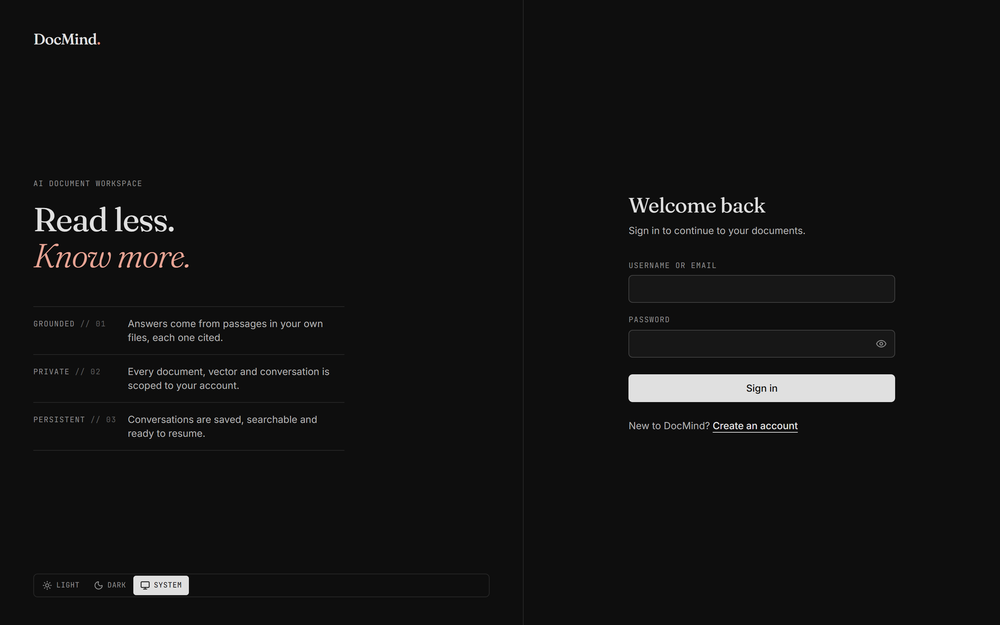
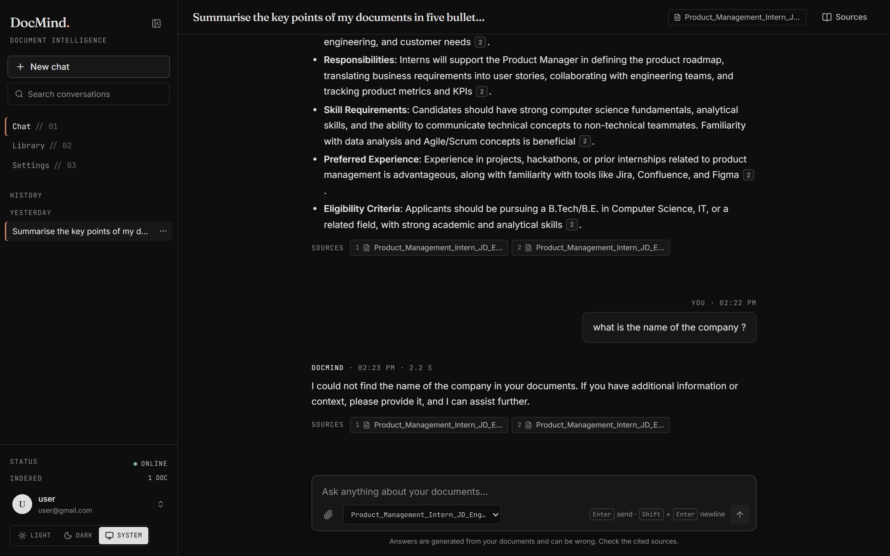
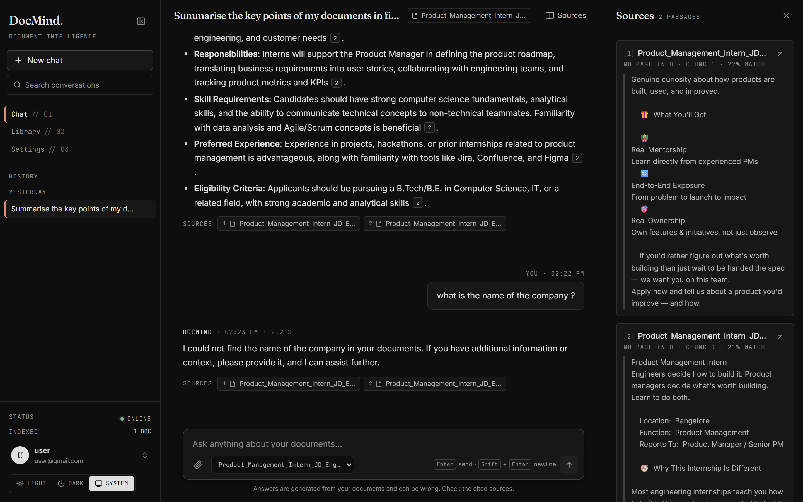
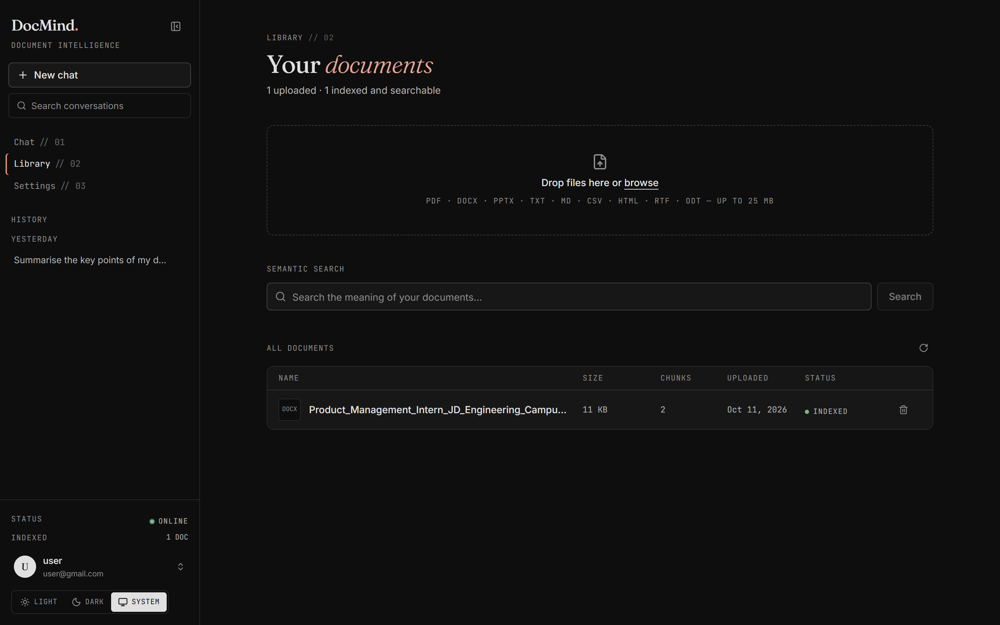
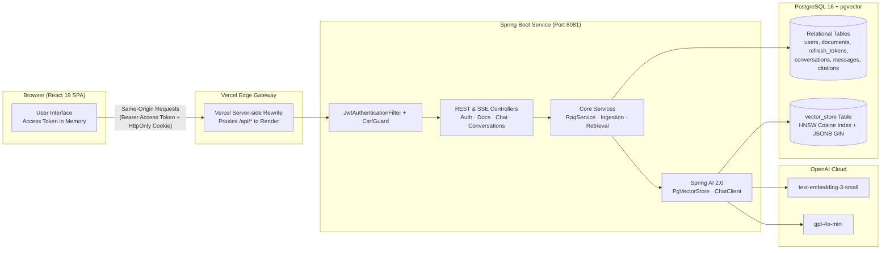
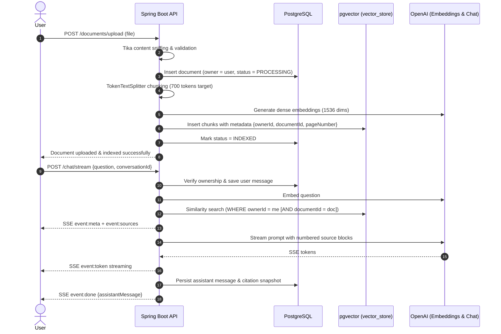
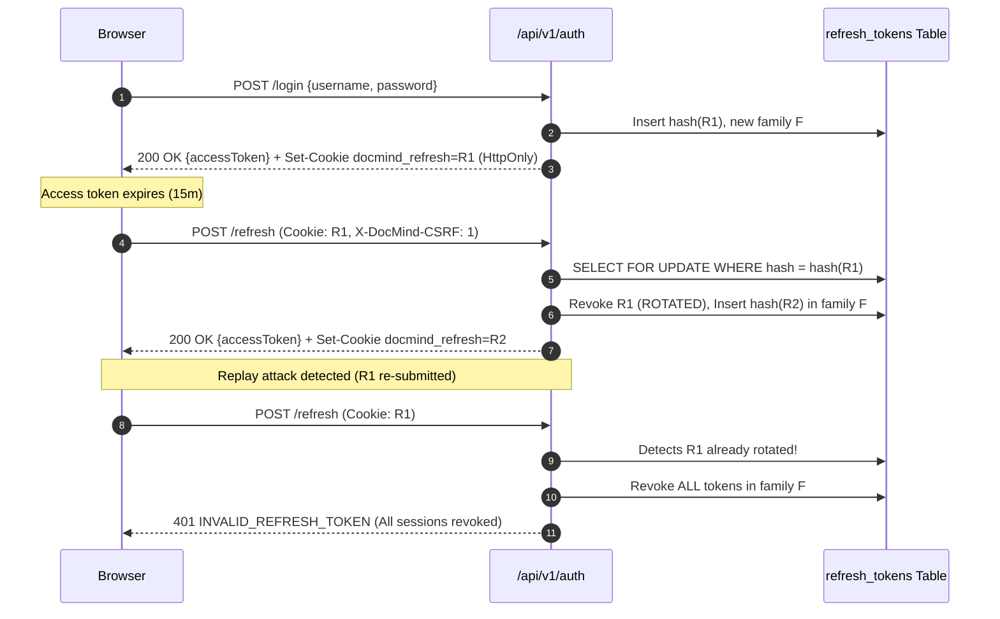
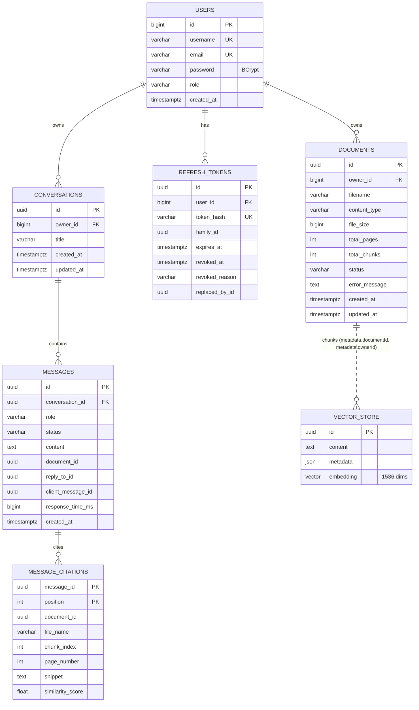
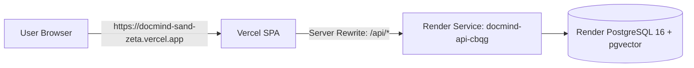

# 🧠 DocMind — Full-Stack AI Document Workspace & Intelligence Platform

[](https://docmind-sand-zeta.vercel.app/)
[](https://docmind-api-cbqg.onrender.com)
[](https://docmind-api-cbqg.onrender.com/swagger-ui/index.html)
[](https://www.oracle.com/java/)
[](https://spring.io/projects/spring-boot)
[](https://github.com/pgvector/pgvector)
[](https://react.dev/)
[](https://www.typescriptlang.org/)
[](https://tailwindcss.com/)

**DocMind** is an enterprise-grade, privacy-first, full-stack AI document workspace. Upload multi-format documents (PDFs, Word files, presentations, and markdown), perform semantic search, and chat interactively with your knowledge base using **Retrieval-Augmented Generation (RAG)** powered by PostgreSQL, pgvector (HNSW indexing), Spring AI, and OpenAI.

Every generated answer contains **verifiable, page-level inline citations (`[1]`, `[2]`)** directly linked to retrieved passage snippets and similarity metrics. Each user account acts as a cryptographically isolated tenant: documents, vector embeddings, conversations, and search results are enforced per-user at the SQL and vector-index levels.
---

## 🌐 Live Deployments & Quick Links

| Service | Link | Description |
|---|---|---|
| 🚀 **Web Application (Frontend)** | [docmind-sand-zeta.vercel.app](https://docmind-sand-zeta.vercel.app/) | Production React SPA hosted on Vercel with automatic API rewrite proxying. |
| ⚡ **Backend API Base URL** | [docmind-api-cbqg.onrender.com](https://docmind-api-cbqg.onrender.com) | Spring Boot REST and SSE streaming service hosted on Render. |
| 📖 **Interactive Swagger UI** | [docmind-api-cbqg.onrender.com/swagger-ui/index.html](https://docmind-api-cbqg.onrender.com/swagger-ui/index.html) | Complete OpenAPI 3.0 interactive specification and endpoint playground. |
| 🩺 **Backend Health Check** | [docmind-api-cbqg.onrender.com/actuator/health](https://docmind-api-cbqg.onrender.com/actuator/health) | Live Spring Boot actuator health probe (`{"status":"UP"}`). |

---

## 📸 Application Screenshots

Captured directly from the running application:

### 1. Authentication & Sign-in
*Minimalist editorial aesthetic featuring Fraunces typography, dark-mode styling, and JWT token protection.*


### 2. AI Document Chat & Citations
*Real-time token streaming with inline citation markers (`[1]`, `[2]`), document scoping filter, and full conversation history.*


### 3. Transparent Source Passages Panel
*Clicking any citation marker or header button slides open exact source chunks with similarity scores, chunk indices, and page metadata.*


### 4. Documents Library & Management Dashboard
*Drag-and-drop file ingestion, real-time status tracking (`PROCESSING` → `INDEXED`), semantic similarity search bar, and document deletion.*


---

## 🛠️ Technologies Used

### Visual Tech Stack
[](https://skillicons.dev)

### Categorized Technology Breakdown

#### 🖥️ Backend Architecture
- **Language & Runtime:** [Java 17 (LTS)](https://www.oracle.com/java/)
- **Core Framework:** [Spring Boot 4.1 / 3.4](https://spring.io/projects/spring-boot) (Spring MVC, Spring Data JPA, Actuator)
- **AI Integration:** [Spring AI 2.0](https://spring.io/projects/spring-ai) (`ChatClient`, `PgVectorStore`, `TokenTextSplitter`)
- **Security:** [Spring Security 7](https://spring.io/projects/spring-security) with stateless JWT filter chain and custom `CookieCsrfGuard`
- **Tokens & Cryptography:** [JJWT (Java JWT)](https://github.com/jwtk/jjwt) for HMAC-SHA access tokens + cryptographically secure opaque refresh tokens
- **Document Parsing & Extraction:** [Apache Tika](https://tika.apache.org/) for multi-format text extraction and MIME-type byte sniffing
- **Database Migrations:** [Flyway](https://flywaydb.org/) for reproducible, version-controlled relational & vector schemas
- **API Documentation:** [SpringDoc OpenAPI 3 / Swagger UI](https://springdoc.org/)

#### 🗄️ Database & Vector Search
- **Primary Database:** [PostgreSQL 16](https://www.postgresql.org/)
- **Vector Extension:** [pgvector](https://github.com/pgvector/pgvector) with **HNSW (Hierarchical Navigable Small World)** indexing and cosine distance
- **Filter Acceleration:** PostgreSQL `jsonb_path_ops` GIN indexes supporting SQL-level `jsonpath` tenant metadata isolation (`hnsw.iterative_scan = relaxed_order`)

#### 🎨 Frontend User Interface
- **Library:** [React 19](https://react.dev/)
- **Language:** [TypeScript 5.9](https://www.typescriptlang.org/) (Strict mode enabled)
- **Build Tool:** [Vite 7](https://vite.dev/) with hot-module replacement and optimized asset hashing
- **Styling:** [Tailwind CSS 4](https://tailwindcss.com/) with editorial theme CSS custom variables
- **Routing:** [React Router 7](https://reactrouter.com/) (Code-split routes, public/protected route guards)
- **Server State & Caching:** [TanStack Query v5](https://tanstack.com/query/latest) (automatic revalidation, optimistic mutations)
- **Icons & Typography:** [Lucide React](https://lucide.dev/), Fraunces Serif, Inter sans-serif, JetBrains Mono
- **Markdown & Code:** `react-markdown` with `remark-gfm` for formatted AI outputs

#### 🧠 AI & LLM Models
- **Chat Generation:** OpenAI `gpt-4o-mini` (or any OpenAI-compatible provider)
- **Embeddings Model:** OpenAI `text-embedding-3-small` (1536-dimensional dense vectors)
- **RAG Architecture:** Chunking with overlap, similarity threshold filtering, contextual prompt injection, and hallucination reduction

#### 🚀 DevOps, Hosting & Tooling
- **Frontend Hosting:** [Vercel](https://vercel.com/) with edge rewrites proxying `/api/*` to Render
- **Backend Hosting:** [Render](https://render.com/) Docker Web Service with native managed PostgreSQL 16 + pgvector
- **Containerization:** Multi-stage [Docker](https://www.docker.com/) builds and [Docker Compose](https://docs.docker.com/compose/) orchestration
- **Testing:** [JUnit 5](https://junit.org/junit5/), [Mockito](https://site.mockito.org/), [Testcontainers](https://testcontainers.com/) (live pgvector in tests), [Vitest](https://vitest.dev/), and [React Testing Library](https://testing-library.com/)

---

## 📋 Table of Contents

1. [Features](#-key-features)
2. [System Architecture](#-system-architecture)
3. [Document Ingestion & RAG Flow](#-document-ingestion--rag-flow)
4. [Security & Authentication Lifecycle](#-security--authentication-lifecycle)
5. [Tenant Isolation](#-per-user-multi-tenant-data-isolation)
6. [Database Schema & Data Model](#-database-schema--data-model)
7. [Vector Search & Indexing](#-vector-search--indexing-design)
8. [Local Development Guide](#-running-locally)
9. [Docker Compose Setup](#-docker-compose-setup)
10. [Cloud Deployment (Render + Vercel)](#-deploying-to-render--vercel)
11. [API Reference & Swagger](#-api-reference--examples)
12. [Testing & Quality Assurance](#-testing)
13. [Troubleshooting Guide](#-troubleshooting)

---

## 🌟 Key Features

### 📁 Intelligent Multi-Format Ingestion
- Upload single or batches of up to 10 files with real-time percentage progress indicators.
- Supported formats: **PDF** (page-by-page chunking preserves exact page numbers for citations), **DOCX**, **DOC**, **PPTX**, **ODT**, **RTF**, **TXT**, **Markdown**, **CSV**, and **HTML**.
- File validation & byte sniffing via Apache Tika: prevents spoofed extensions (`415`), rejects empty documents, and enforces a 25 MB file limit.
- Lifecycle states: `PROCESSING` → `INDEXED` or `FAILED`. Image-only scanned PDFs without text fail gracefully with actionable error reasons.

### 💬 Grounded AI Conversations
- Chat across all user documents or target questions to a specific document.
- Real-time token streaming using **Server-Sent Events (SSE)**.
- **Accurate inline citations:** Clicking `[1]` or `[2]` opens the retrieved passage snippet, page number, and vector similarity score.
- Conversation persistence: conversations are stored in PostgreSQL with thread title auto-generation from the initial query.
- Resilient recovery: network interruptions or model timeouts preserve the query; click **Retry** to regenerate without duplicate history.

### 🔍 Semantic Vector Search
- Perform direct semantic vector searches against your document library to find matching passages with similarity scores before or outside of conversations.
- History search: filter and search past conversations by title and message content.

### 🛡️ Enterprise-Grade Security
- Dual-token authentication: stateless 15-minute memory-only JWT access tokens + 7-day `HttpOnly`, `SameSite=Strict` rotating refresh cookies.
- Automatic refresh token rotation with family theft detection (replay of an old refresh token instantly invalidates the entire session family).
- Multi-tenant isolation at the database level: queries enforce `WHERE owner_id = :userId` in relational tables and `metadata::jsonb @@ '$.ownerId == "..."'` in pgvector.

---

## 📐 System Architecture



---

## 🔄 Document Ingestion & RAG Flow



---

## 🔐 Security & Authentication Lifecycle

DocMind enforces the principle of least privilege using a dual-token strategy:

| Attribute | Access Token | Refresh Token |
|---|---|---|
| **Format** | Signed JWT (HS512 JJWT) | Cryptographically secure 256-bit random opaque string |
| **Lifetime** | 15 minutes (`JWT_ACCESS_TTL`) | 7 days (`REFRESH_TOKEN_TTL`) |
| **Client Storage** | Application memory only (never localStorage) | `HttpOnly`, `SameSite=Strict`, `Secure` Cookie (`Path=/api/v1/auth`) |
| **Server Storage** | Stateless verification | SHA-256 hash in `refresh_tokens` table |
| **Claims / Meta** | `sub` (userId), `typ=access`, `iss`, `iat`, `exp` | `user_id`, `family_id`, `expires_at`, `revoked_at`, `replaced_by_id` |



### Security Measures:
- **Token Type Isolation:** The filter rejects refresh tokens presented in the `Authorization` header, and the refresh endpoint only accepts the HttpOnly cookie.
- **CSRF Defense:** Bearer token routes are immune to CSRF. Cookie-based routes (`/refresh`, `/logout`) require an `X-DocMind-CSRF: 1` header, exact-origin verification, and `SameSite=Strict` cookies.
- **Concurrent Tab Refreshes:** A 10-second grace window resolves simultaneous tab refreshes (`409 REFRESH_CONFLICT`) cleanly without false theft triggers.
- **Scheduled Token Pruning:** Daily cron job (`03:15 UTC`) purges expired or revoked tokens older than 7 days.

---

## 🔒 Per-User Multi-Tenant Data Isolation

DocMind prevents cross-tenant data leakage across three independent tiers:

1. **Authentication Token as Single Source of Identity:** Controllers consume an `AuthUser` principal extracted directly from the verified JWT. Endpoints never accept an untrusted user ID from client request parameters.
2. **Relational Query Scoping:** Every JPA repository operation queries by both primary key and owner ID:
   ```java
   Optional<DocumentMetadata> findByIdAndOwnerId(UUID id, Long ownerId);
   ```
   Requests for foreign entities return `404 Not Found` rather than leaking resource existence.
3. **Database-Level Vector Scoping:** Chunks in `vector_store` store `ownerId` in JSONB metadata. Every vector search applies a Spring AI filter predicate compiled into PostgreSQL JSON path operators:
   ```sql
   metadata::jsonb @@ '$.ownerId == "1"'
   ```
   No vector belonging to another tenant is ever read from disk into memory.

---

## 🗃️ Database Schema & Data Model



Migrations are managed with Flyway (`src/main/resources/db/migration`):
- `V1__baseline.sql`: `vector` extension, `users`, `documents`, `vector_store` table, HNSW cosine index, and GIN JSON path index.
- `V2__refresh_tokens.sql`: Token hash table, family index, and expiration indexes.
- `V3__conversations.sql`: Threads, messages, and citation snapshots.

---

## ⚡ Vector Search & Indexing Design

- **Vector Store:** Spring AI `PgVectorStore` mapped to `vector_store`.
- **Dimensions:** 1536 (`text-embedding-3-small`).
- **Distance Metric:** Cosine distance (`<=>`).
- **Index Type:** **HNSW** (`m=16`, `ef_construction=64`).
- **Filtered Recall:** Connections set `SET hnsw.iterative_scan = relaxed_order` to prevent sparse candidate drops when filtering by `ownerId`.
- **Chunking Pipeline:** `TokenTextSplitter` targets 700 tokens per chunk with 100-token overlap. Metadata is normalized to `{ownerId, documentId, fileName, contentType, chunkIndex, pageNumber}`.
- **Safety Against Prompt Injection:** Retrieved chunks are injected as delimited `<source id="n">` XML blocks. Source tags in raw user documents are sanitized before LLM transmission.

---

## 💻 Running Locally

### Prerequisites
- **Java 17+** (JDK 17 or 21)
- **Node.js 20.19+** (Node 22 or 24 recommended) & `npm`
- **Docker & Docker Compose** (for PostgreSQL + pgvector)
- **OpenAI API Key** (optional for startup; app runs in dev mode with stubs if unset)

### 1. Clone the Repository
```bash
git clone https://github.com/sahamon-141/docmind.git
cd docmind
```

### 2. Start PostgreSQL with pgvector
```bash
docker compose up -d postgres
```
*Starts PostgreSQL 16 with pgvector on `localhost:5434` (database `docmind`, username `postgres`, password `postgres`).*

### 3. Start the Spring Boot Backend
On Linux / macOS:
```bash
export OPENAI_API_KEY="sk-your-openai-api-key"
./mvnw spring-boot:run
```

On Windows (PowerShell):
```powershell
$env:OPENAI_API_KEY = "sk-your-openai-api-key"
.\mvnw.cmd spring-boot:run
```
*The backend API will start on **http://localhost:8081**.*

### 4. Start the Vite React Frontend
```bash
cd frontend
npm install
npm run dev
```
*Open **http://localhost:5173** in your browser.*

### 5. Sign In & Explore
You can sign in with an existing account
Or click **Create an account** to register a new tenant workspace.

---

## 🐳 Docker Compose Setup

Run the full stack (PostgreSQL + pgvector + Spring Boot + Nginx-served frontend) in isolated containers:

```bash
cp .env.example .env
# Edit .env and supply your OPENAI_API_KEY and a random JWT_SECRET (openssl rand -base64 48)
docker compose --profile app up -d --build
```

| Service | Access URL |
|---|---|
| Frontend Web Application | [http://localhost:8080](http://localhost:8080) |
| Backend API & Swagger UI | [http://localhost:8081/swagger-ui.html](http://localhost:8081/swagger-ui.html) |
| PostgreSQL Container | `localhost:5434` |

To stop the containers:
```bash
docker compose --profile app down
```

---

## ☁️ Deploying to Render & Vercel

The production stack deploys the backend and database to **Render**, and the frontend to **Vercel**.



### Why the Vercel Proxy Rewrite Matters
`vercel.app` and `onrender.com` are cross-site origins. Direct cross-site calls would cause browsers (Safari, Firefox, Chrome) to treat the `docmind_refresh` cookie as a third-party cookie and block it, signing users out on every reload. 
By defining the rewrite in `frontend/vercel.json`:
```json
{
  "rewrites": [
    {
      "source": "/api/:path*",
      "destination": "https://docmind-api-cbqg.onrender.com/api/:path*"
    },
    {
      "source": "/actuator/:path*",
      "destination": "https://docmind-api-cbqg.onrender.com/actuator/:path*"
    }
  ]
}
```
The browser communicates exclusively with the Vercel domain, keeping the cookie **first-party** with `SameSite=Strict`.

---

## 📖 API Reference & Examples

Interactive Documentation is live at:
👉 **[Swagger UI: docmind-api-cbqg.onrender.com/swagger-ui/index.html](https://docmind-api-cbqg.onrender.com/swagger-ui/index.html)**
*(OpenAPI JSON specification available at `/v3/api-docs`)*

### Core REST Endpoints

| Method | Endpoint | Auth | Description |
|---|---|---|---|
| `POST` | `/api/v1/auth/register` | Public | Register new user account (`201 Created`) |
| `POST` | `/api/v1/auth/login` | Public | Sign in with username/email & password (`200 OK`) |
| `POST` | `/api/v1/auth/refresh` | Cookie | Rotate refresh token & issue new access token |
| `POST` | `/api/v1/auth/logout` | Cookie | Revoke refresh token family & clear cookie |
| `GET` | `/api/v1/auth/me` | Bearer | Get authenticated user profile |
| `POST` | `/api/v1/documents/upload` | Bearer | Upload and vectorize single document (`multipart/form-data`) |
| `POST` | `/api/v1/documents/upload-multiple` | Bearer | Upload up to 10 documents in parallel |
| `GET` | `/api/v1/documents` | Bearer | List documents belonging to authenticated user |
| `DELETE` | `/api/v1/documents/{id}` | Bearer | Delete document and cascade delete its vector chunks |
| `POST` | `/api/v1/chat/query` | Bearer | Ask a question and await synchronous JSON response |
| `POST` | `/api/v1/chat/stream` | Bearer | Ask a question and receive token-by-token SSE stream |
| `POST` | `/api/v1/chat/search/similarity`| Bearer | Semantic vector search across passages |
| `GET` | `/api/v1/conversations` | Bearer | List / search past conversation threads |
| `GET` | `/api/v1/conversations/{id}` | Bearer | Fetch conversation thread with messages & citations |
| `DELETE`| `/api/v1/conversations/{id}` | Bearer | Delete conversation thread and messages |
| `GET` | `/actuator/health` | Public | Health probe endpoint |

### Example cURL Queries

#### 1. Upload a Document
```bash
curl -X POST http://localhost:8081/api/v1/documents/upload \
  -H "Authorization: Bearer <YOUR_ACCESS_TOKEN>" \
  -F "file=@document.pdf"
```

#### 2. Stream Question Answering (SSE)
```bash
curl -N -X POST http://localhost:8081/api/v1/chat/stream \
  -H "Authorization: Bearer <YOUR_ACCESS_TOKEN>" \
  -H "Content-Type: application/json" \
  -H "Accept: text/event-stream" \
  -d '{"question": "What is the product roadmap described in the document?"}'
```

---

## 🧪 Testing

The repository maintains full test coverage across both backend and frontend layers:

```bash
# 1. Run Backend Unit & Integration Tests (Docker required for Testcontainers pgvector)
./mvnw test

# 2. Run Frontend Tests & Linting
cd frontend
npm run typecheck     # Strict TypeScript verification
npm run lint          # ESLint (zero warnings allowed)
npm test              # Vitest test suite
npm run build         # Production bundle verification
```

- **Backend (51 Integration & Unit Tests):** Integration tests spin up a real `pgvector/pgvector:pg16` Docker container via Testcontainers to validate JSON path SQL filtering, HNSW cosine index behavior, Flyway schema upgrades, and multi-tenant isolation.
- **Frontend (18 Vitest Tests):** Covers single-flight token refresh, concurrent 401 handling, session restore, route guards, SSE event parsers, and Markdown citation security.

---

